# exp3 前端（React 19 + TypeScript + Vite 7）

SCOUT MINI 远程巡检控制台。前后端分离：本目录是独立的 React 单页应用，通过 `/api/v1/**` 调用 [`../backend`](../backend)。生产环境由 nginx 同源提供静态文件并反代 API；开发环境由 Vite 代理 `/api` 到本机后端，避免跨域。

## 功能

| 页面 | 内容 |
| --- | --- |
| 登录 | 后端 JWT 登录；令牌只保存在内存，刷新页面即退出；401 自动回登录页 |
| 总览 | 机器人名称/编号、在线/MQTT/底盘状态、电池电压、速度、里程计位姿、最近回执、每秒轮询 |
| 巡检 | 路线点位增删改查、任务计划增删改查（草稿/已计划/已取消、计划时间）；OPERATOR 可编辑，其他角色只读 |
| 控制 | 按住方向键行驶（每 200 ms 续发）、松开/切页/失焦/退出登录自动 STOP、独立急停；按角色禁用 |
| 告警 | 级别/状态筛选、分页；MONITOR 可在页面确认告警 |
| 日志 | 操作类型筛选、分页；后端按角色限制本人/全部范围 |

未实现：任务下发执行、导航/SLAM、WebSocket 实时推送；移动端使用响应式布局，不做独立移动端应用。

## 界面预览

以下为本地模拟数据下的界面截图（用于展示视觉，不是实车联调记录）。点阵仅出现在登录页，登录后的控制台为无点阵的纯白/纯黑背景：

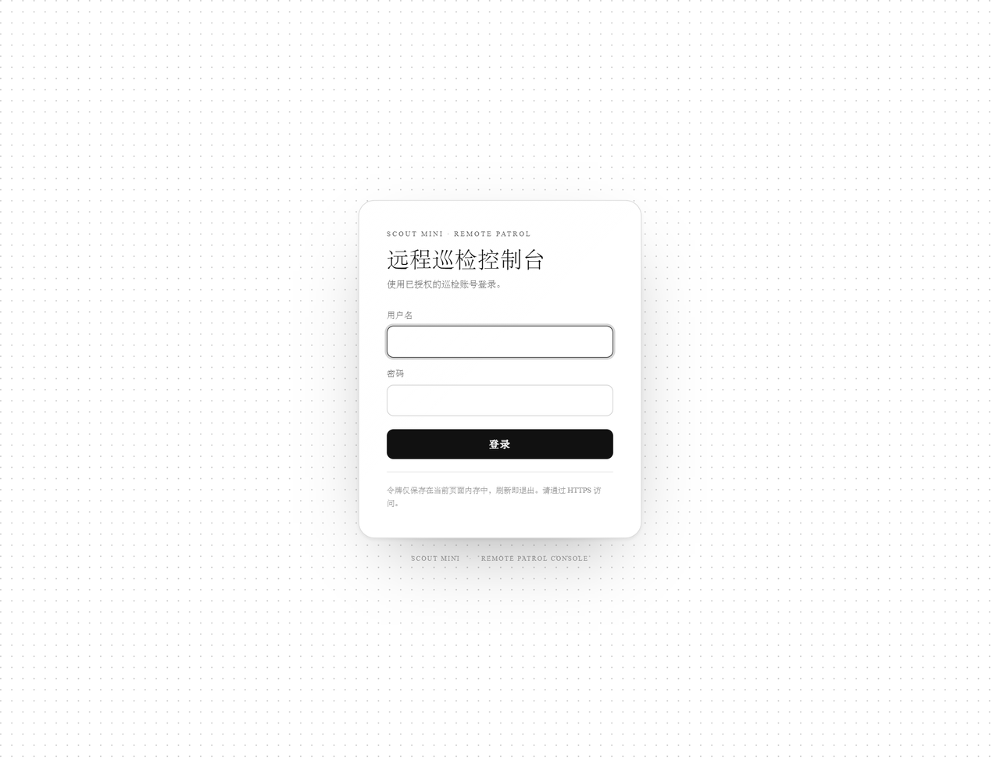

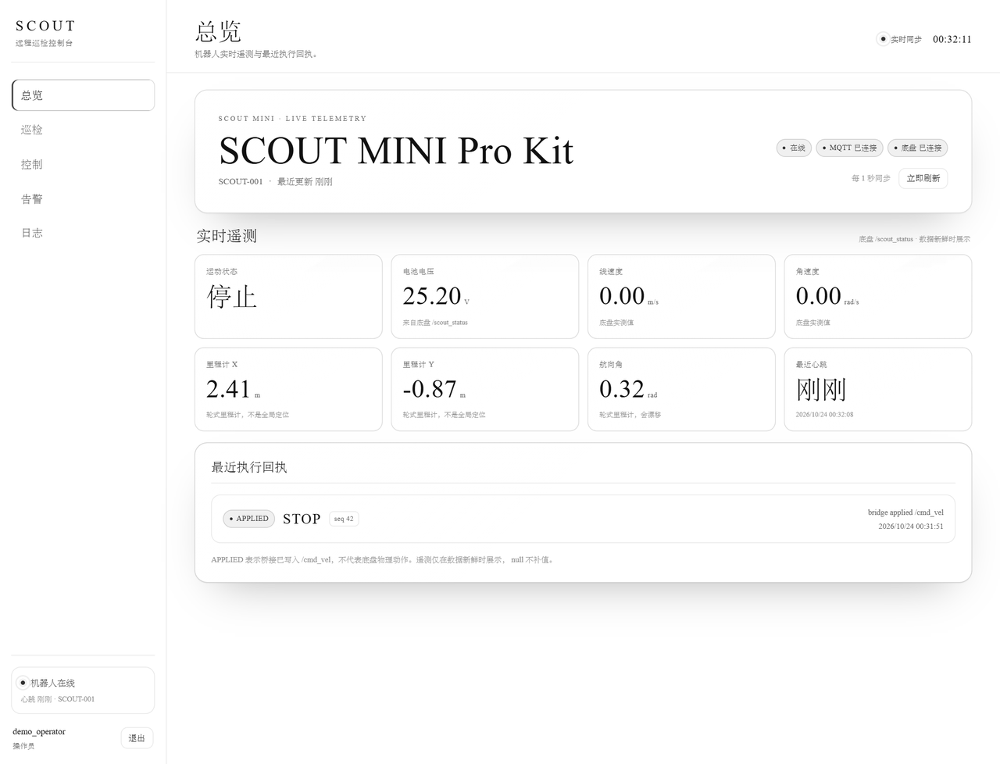

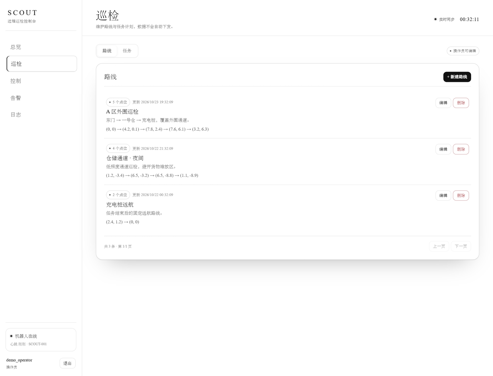

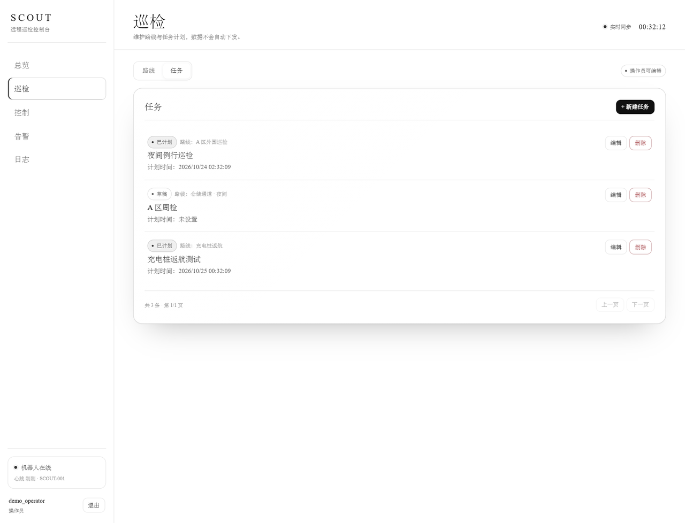

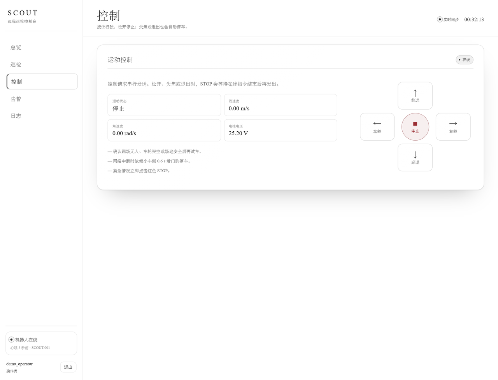

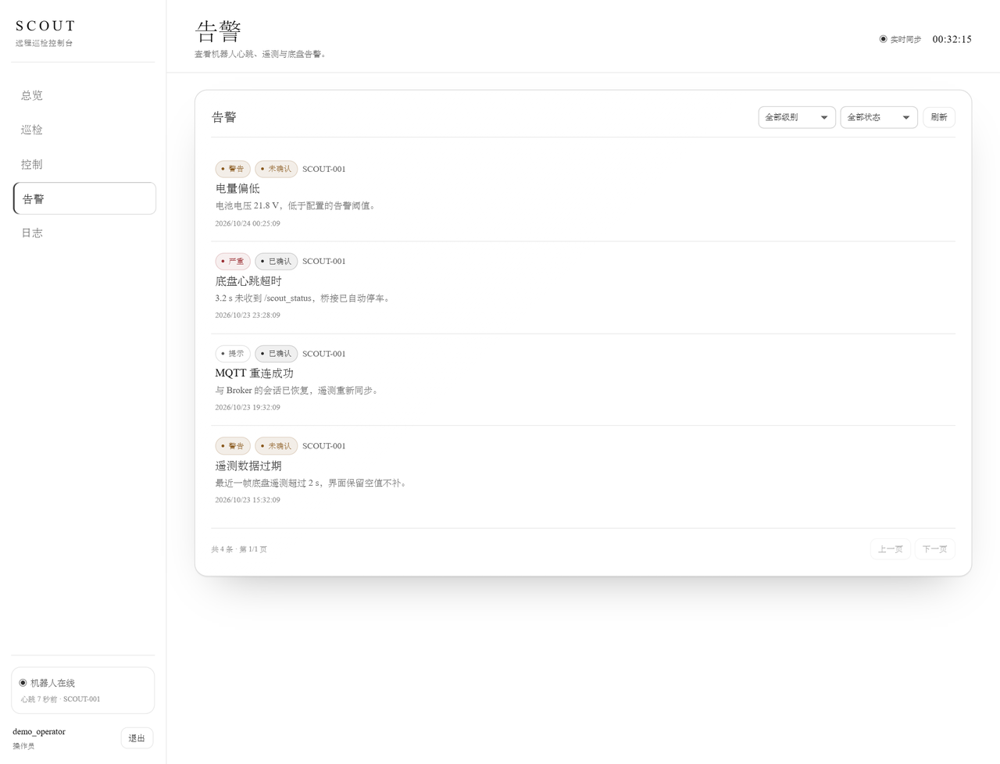

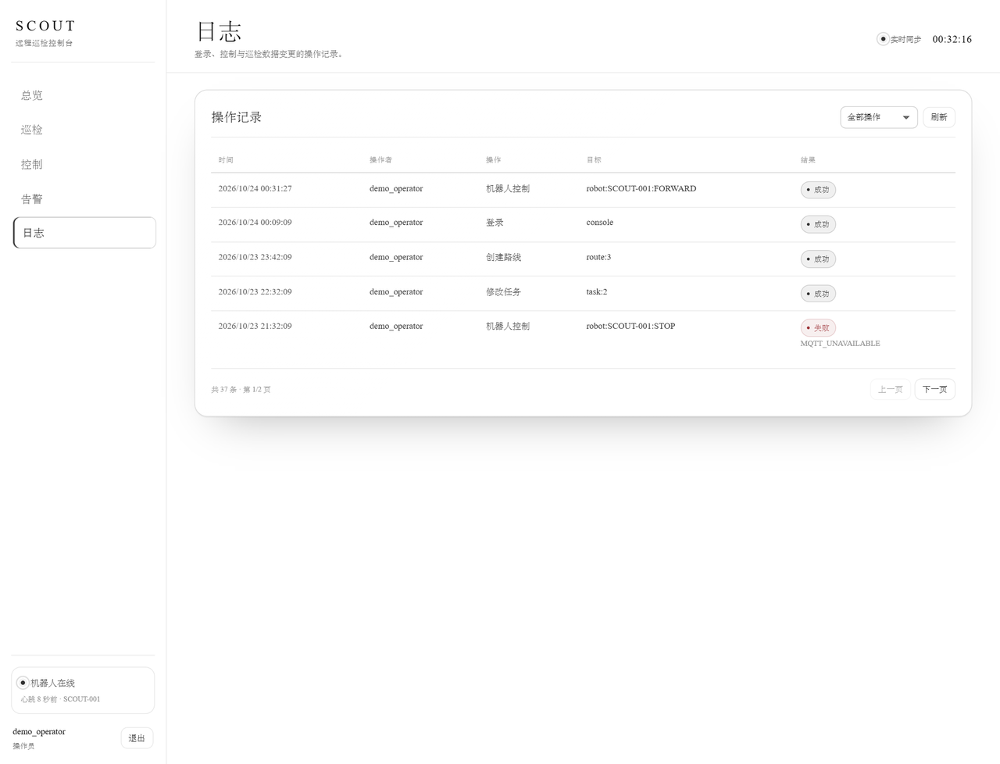

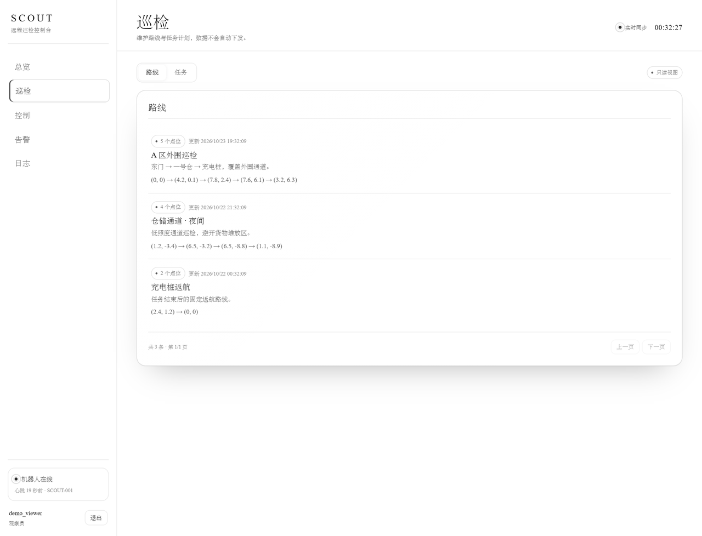

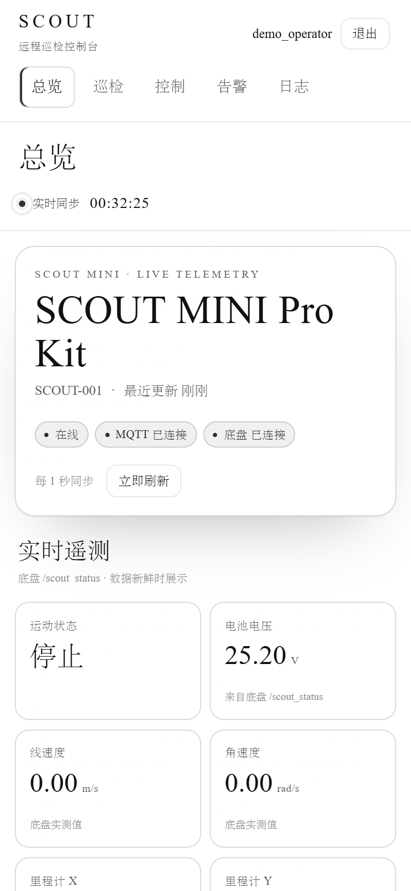

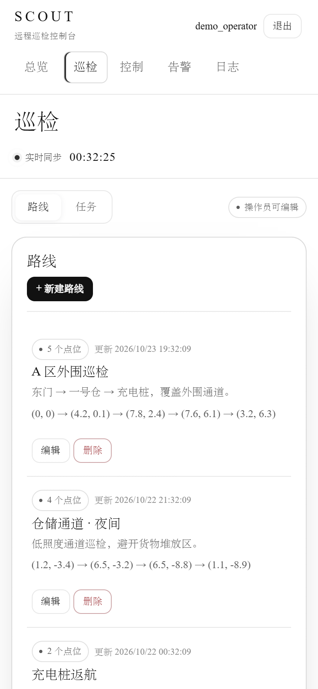

深色模式（跟随系统）：

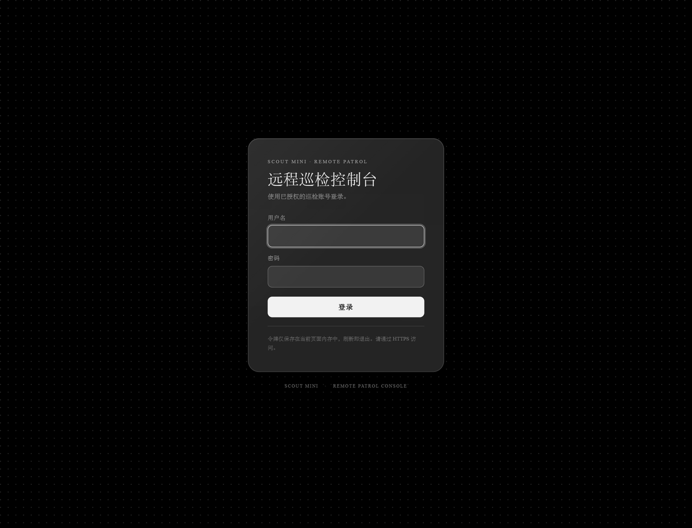

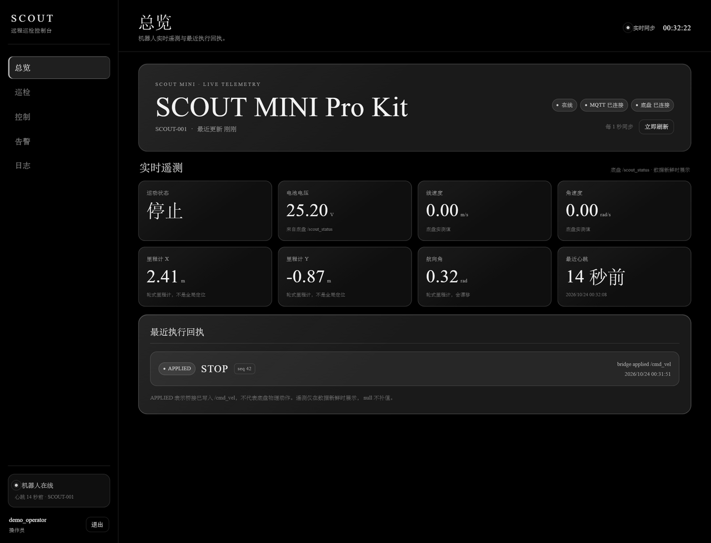

## 界面风格

- **字体**：中文使用系统宋体（`Songti SC` / `SimSun` / `STSong`），西文使用 `Times New Roman`。字体栈为
  `'Times New Roman', 'Songti SC', STSong, SimSun, 'Noto Serif CJK SC', serif`；不加载外部字体。
- **登录页点阵**：只有登录页渲染点阵背景。浅色为纯白底 + `rgba(0, 0, 0, 0.18)` 灰点，深色为纯黑底 + `rgba(255, 255, 255, 0.15)` 灰点；点距收紧到 **16px**，铺满登录页视口。点阵是静态的，没有波纹、漂移或亮暗波动。
- **登录后背景**：dashboard、巡检、控制、告警、日志不再渲染点阵，保持纯白/纯黑背景，让卡片和内容更安静；顶栏与侧栏保持透明，只留 1px 发丝线。
- **磨砂玻璃**：登录面板、弹窗和卡片使用半透明白/黑玻璃、细边框、柔和阴影和
  `backdrop-filter: blur(...) saturate(...)`。
- **控件交互**：按钮/导航 hover 位移、卡片 hover 阴影、输入 focus 环、方向盘按住缩放并触发
  `press-ring` 波纹；`prefers-reduced-motion: reduce` 下关闭控件过渡和指示灯动画。
- **无图形 logo**：界面只保留文字品牌名 “SCOUT” 和页面标题，登录页没有品牌图形标记。
- **CSP 兼容**：无内联脚本、无内联 `style` 属性、无外部 CDN，生产构建保持
  `script-src 'self'; style-src 'self'`。

## 1. 开发

需要 Node.js 20.19+ 或 22.12+（Vite 7 要求）。

```bash
cd exp3/frontend
npm ci
npm run typecheck
npm test
npm run dev
```

打开 <http://127.0.0.1:5173/>。Vite 已把 `/api` 代理到 `http://127.0.0.1:8080`，后端开发启动示例：

```bash
cd exp3/backend
PATROL_WEB_ALLOWED_ORIGINS=http://127.0.0.1:5173 \
  ./scripts/Run-Demo.ps1 -MqttUrl tcp://127.0.0.1:1883
```

> Vite 代理只解决浏览器同源；如果后端仍校验 `Origin`，把 `http://127.0.0.1:5173` 加入 `PATROL_WEB_ALLOWED_ORIGINS`。

`VITE_API_BASE_URL` 只用于需要直连后端的开发场景；生产构建不要设置，保持同源。非回环地址的 `http://` 会被前端拒绝启动。

## 2. 构建与部署

```bash
npm ci
npm run typecheck
npm test
npm run build
```

产物在 `dist/`。完整服务器部署（nginx、HTTPS、反向代理、限流、验收）见 [`deploy/README.md`](deploy/README.md)。

nginx 配置：

- [`deploy/nginx-http.conf`](deploy/nginx-http.conf)：首次申请证书
- [`deploy/nginx-tls.conf`](deploy/nginx-tls.conf)：正式 HTTPS
- [`deploy/security-headers.conf`](deploy/security-headers.conf)：HSTS/CSP 等安全头

部署目录是 `/var/www/agilex`，不是源码目录。

## 3. 目录

```text
src/
  main.tsx                    入口
  App.tsx                     会话、登录/退出、页面切换
  config.ts                   API 地址/超时/轮询间隔与 HTTPS 校验
  api/client.ts               typed fetch 客户端、错误码、401 回调
  api/types.ts                后端 JSON 类型
  control/HoldController.ts   按住续发、串行化、STOP 顺序保证
  control/useHoldControl.ts   React 绑定
  robot/RobotContext.tsx      1 Hz 状态轮询、命令发送
  components/                 布局、卡片、分页、Modal、状态标签
  components/Atmosphere.tsx   登录页静态点阵
  components/DotPattern.tsx   Magic UI Dot Pattern 的静态改写
  pages/                      登录、总览、巡检、控制、告警、日志
  utils/format.ts             中文格式化
  styles.css                  登录页点阵 + 无点阵控制台、宋体/Times New Roman、磨砂玻璃
deploy/                       nginx 配置、部署与自检脚本
docs/screenshots/             界面截图（模拟数据）
```

## 4. 安全设计

- **令牌**：JWT 仅存在 `ApiClient` 私有字段（内存），不写 `localStorage`、`sessionStorage`、URL 或日志；刷新页面必须重新登录。
- **传输**：生产强制 HTTPS；`VITE_API_BASE_URL` 为非回环 `http://` 时应用直接显示配置错误。nginx 配置 HSTS/CSP/nosniff/X-Frame-Options。
- **CSP**：`script-src 'self'`、`style-src 'self'`、`connect-src 'self'`，无内联脚本、无外部 CDN；中文宋体与西文 Times New Roman 均为系统字体，不产生外部字体请求。生产构建已按严格 CSP 验证。
- **角色**：界面只做禁用/隐藏；真正权限由后端 `RobotCommandExecutor`、`RolePolicy` 和 Spring Security 校验。MONITOR 只能 STOP，VIEWER 只读。
- **运动安全**：按住每 200 ms 续发，请求串行化；松开、指针取消、失焦、切页、退出都 STOP；STOP 会等在途 keepalive 完成后发送，避免迟到 FORWARD 覆盖 STOP。小车侧 0.6 s 看门狗是最后兜底。
- **退出并发**：退出时先尽力 STOP，再清除令牌；新登录的令牌不会被旧会话异步清理（`ApiClient` 单实例，登录后旧请求不会覆盖新 token）。
- **错误处理**：只展示后端返回的中文消息；不记录请求体、密码或 Token。401 统一回到登录页。
- **登录入口**：nginx 对 `/api/v1/auth/login` 限流 10 次/分钟（burst 5），生产屏蔽 Swagger。
- **CORS**：生产 `backend.env` 必须设置 `PATROL_WEB_ALLOWED_ORIGINS=https://agilex.yoyoyan.cn`；未列出时浏览器登录会 403。

## 5. 测试与验证

```bash
npm run typecheck   # tsc --noEmit
npm test            # 13 项：API 7、HoldController 4、LoginPage 2
npm run build       # Vite production build
```

2026-10-24 视觉改版验证（本地模拟数据 + 生产构建 + 严格 CSP，不是实车）：

- `npm run typecheck` 通过；`npm test` 13 项全部通过；`npm run build` 成功。
- 用本地静态服务器按生产 CSP 提供 `dist/`，以 Playwright + 模拟 API 走完登录、总览、巡检、控制、告警、日志与路线/任务弹窗：0 控制台错误、0 页面异常、0 个内联 `style` 属性。
- 主题核验：登录页浅色 `body` 背景 `rgb(255,255,255)`、点阵 `rgba(0,0,0,0.18)`、点距 16px；深色 `body` 背景 `rgb(0,0,0)`、点阵 `rgba(255,255,255,0.15)`；登录页点阵 `animation-name: none`、`mask-image: none`，波纹元素数量为 0；登录后的 dashboard `.atmosphere` 数量为 0，即不再渲染点阵。
- 顶栏与侧栏计算背景为透明；点阵为静态背景，无波动动画；`prefers-reduced-motion: reduce` 下仅保留控件过渡的降级。
- 登录面板计算背景为半透明白色并带 `blur(32px) saturate(1.2)`；主卡片使用 55% 白玻璃；深色使用深色半透明玻璃。
- 请求路径与请求体未变：`POST /api/v1/auth/login`、`GET /api/v1/robot/status`、`GET /api/v1/robot`、`GET/POST /api/v1/routes`、`GET/POST /api/v1/tasks`、`GET /api/v1/alarms`、`PATCH /api/v1/alarms/{id}/ack`、`GET /api/v1/control-logs`、`POST /api/v1/robot/control`。
- 按住前进约 0.8 s，后端收到 5 次 `FORWARD`，松开后收到 `STOP`；退出登录再发一次 `STOP`。
- 交互核验：方向盘 hover 位移 `translateY(-2px)` 并出现环与阴影，按住缩放 `scale(0.94)`、背景切换为按钮反色、`press-ring` 动画运行；松开恢复。
- MONITOR 可确认告警、前进按钮禁用但 STOP 可用；VIEWER 巡检页没有新建/编辑按钮。
- 1440、820、390、320 宽度均无横向溢出。
- 截图使用模拟数据；视觉改版后尚未重新进行真实后端/真实小车联调。

改版前的全栈联调记录（API 客户端与按住控制逻辑未改，视觉层已重写）：

- 登录 → 总览显示在线、21.80 V、位姿；
- 按住前进 0.9 s 期间观察到 ≥3 条 FORWARD，松开后 STOP；
- 路线创建/编辑/删除，任务创建/编辑为“已计划”，被任务引用的路线删除返回 409；
- 告警页显示“电量过低”，日志页读取到控制/登录记录；
- 操作员/监控员/观察员角色控制通过；
- 真实 nginx 1.28 HTTPS（自签）下 CSP 无报错，控制 E2E 与巡检 CRUD E2E 通过；
- 页面无未捕获异常；除预期的 409 外无控制台错误。

这些是本地模拟底盘结果，**不等于实车运动验证**；实车测试仍需按 [`../PROGRESS.md`](../PROGRESS.md) 第 8 节进行。
